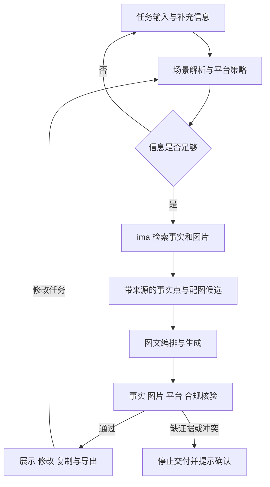

# 计划架构

当前文档描述计划结构；已实现状态以 README 功能进度及实际运行记录为准。

## ima 边界

按官方 Skill / OpenAPI 的实际返回对接，不能根据文档中的示例推断所有字段。预期步骤：确认账号与共享库 → 搜索资料 → 搜索为空时浏览目录 → 获取原文或媒体信息 → 结构化提取证据。

ima 提供事实和图片；团队的 Agent 实现场景策略、平台规则、内容编排和核验。开发期样例必须标注，正式演示保存真实调用及来源证明。

## 平台策略

| 平台 | 结构 | 图片数量 | 行动引导 |
|---|---|---|---|
| 小红书 | 口语标题、场景、短段落、标签 | 3–6 | 咨询需求、收藏或体验 |
| 公众号 | 标题、导语、分节正文、结尾 | 2–4 | 了解详情或预约体验 |
| 门店朋友圈 | 短文案、一个核心卖点 | 1–3 | 到店或私信咨询 |

切换平台要改变结构、语气、配图和行动引导。切换场景要改变用户问题、切入点和卖点优先级。

## 本轮实现优先级

先完成单条可运行流程和真实来源，再改善生成质量与体验；先验证两个具体型号的检索与换型号能力。应用框架、模型服务及部署环境在团队开工时确定，不预设已接通任何服务。
