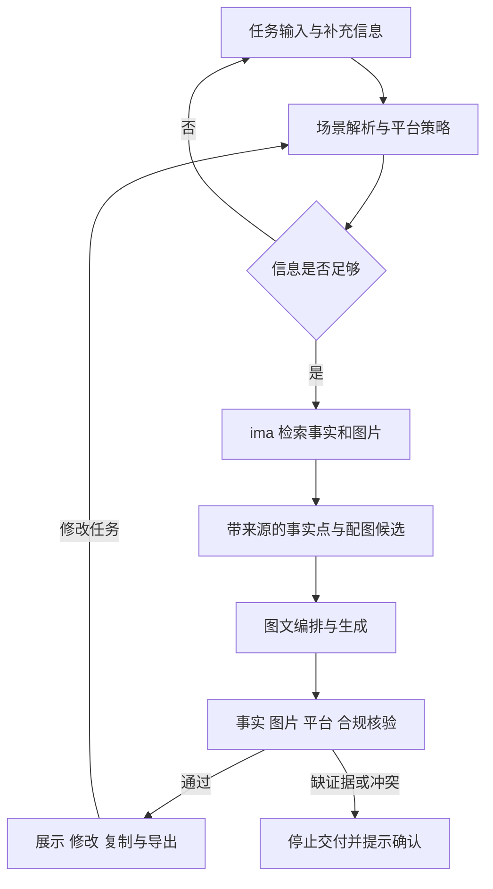

# 当前架构

当前代码已实现下列主流程；真实参赛完成状态以 README 和实际运行记录为准。

## ima 边界

按官方 Skill / OpenAPI 的实际返回对接，不能根据文档中的示例推断所有字段。预期步骤：确认账号与共享库 → 搜索资料 → 搜索为空时浏览目录 → 获取原文或媒体信息 → 结构化提取证据。

ima 提供事实和图片；团队的 Agent 实现场景策略、平台规则、内容编排和核验。开发期样例必须标注，正式演示保存真实调用及来源证明。

## 平台策略

| 平台 | 结构 | 图片数量 | 行动引导 |
|---|---|---|---|
| 小红书 | 口语标题、场景、短段落、标签 | 3–6 | 咨询需求、收藏或体验 |
| 公众号 | 标题、导语、分节正文、结尾 | 2–4 | 了解详情或预约体验 |
| 门店朋友圈 | 短文案、一个核心卖点 | 1–3 | 到店或私信咨询 |

切换平台要改变结构、语气、配图和行动引导。切换场景要改变用户问题、切入点和卖点优先级。

## 当前实现与验收顺序

本地 Python 服务负责 ima 只读检索、调用包、模型请求和核验，浏览器工作台负责任务输入、资料确认、结果展示、修改与导出。下一步先用一个明确型号完成 T01 真实运行，再验证换平台、换场景和相近型号；模型服务及部署环境由本机配置决定，仓库不包含可用密钥。
